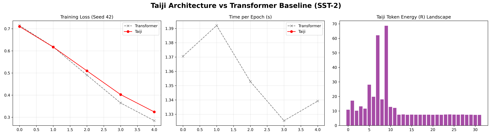
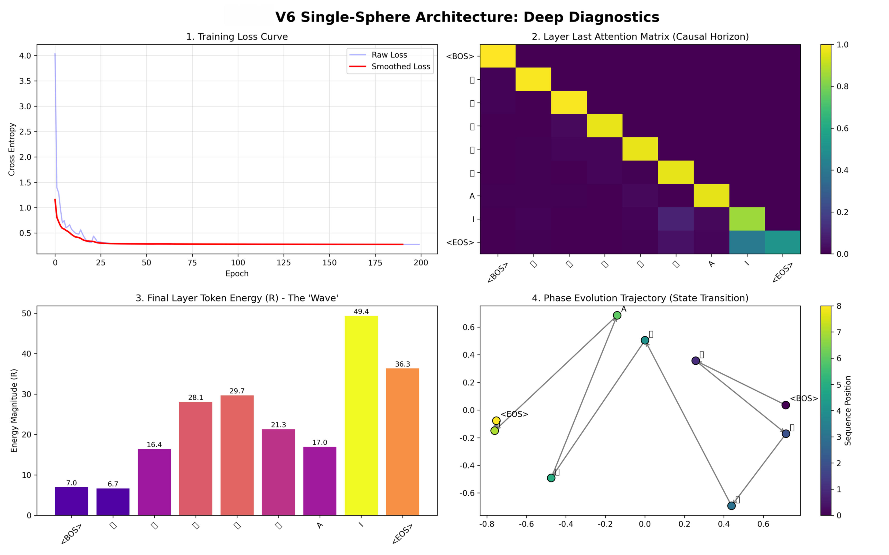

# 太极单球架构 (Taiji Single-Sphere Architecture, TSA)

## 简介

TSA 是一种脱离传统 Transformer QKV 投影矩阵与多头机制的底层架构原型。

基于几何与物理学第一性原理，TSA 将语义表示物理拆解为“纯方向（相位）”与“标量能量（半径）”。在计算过程中，模型不再混合高维特征，而是仅按权重吸收历史词汇的标量能量。该机制在保持当前词汇本体方向不被污染的前提下，实现了高效的上下文状态转移。

### 机制对比

| 维度 | 传统 Transformer | TSA 太极架构 |
| :--- | :--- | :--- |
| **投影矩阵** | 依赖独立的 \(W_q, W_k, W_v\) | 无投影矩阵，直接拆分本体向量 |
| **特征聚合** | 高维特征向量混合 (特征污染) | 纯标量能量聚合 (相对包含) |
| **推理缓存 (KV Cache)** | 需缓存庞大的 Key 与 Value 矩阵 | 仅需缓存方向与标量能量 |
| **因果控制** | 掩码(Mask)硬截断 | 掩码锁定因果边界 + 能量波浪驱动演化 |

---

## 实验验证

在无预训练、同参数量（3层 / 128维）的标准下，TSA 在真实自然语言任务中的表现如下：

### 1. 自然语言理解 (SST-2 情感分类)
采用 3 个独立随机种子测试求均值。在**完全抛弃 QKV 投影矩阵**的前提下，TSA 达到了与标准 Transformer 相当的性能。

| 模型 | 验证集准确率 (均值 ± 标准差) |
| :--- | :--- |
| Standard Transformer | 70.0% ± 1.0% |
| **TSA (太极单球)** | **69.3% ± 2.9%** |


*图 1：多随机种子下的平均准确率对比*


*图 2：Loss、耗时及能量分布全景对比*

### 2. 自回归生成
在对话生成任务中，模型收敛稳定（Loss 降至 0.27）。注意力矩阵呈标准下三角分布，能量分布符合语义权重特征。


*图 3：因果视界热力图与能量分布波形*

### 3. 长文本推理显存 (KV Cache)
由于消除了高维 V 矩阵，TSA 在长序列推理时显著降低了缓存显存。

*   **理论推导**：在 8192 维模型下，TSA 的 Cache 消耗约为标准 Transformer 的 50.006%。
*   **实测数据**：在 4096 序列长度下，实测显存节省率为 36.1%。


*图 4：长序列推理显存峰值对比*

---

## 代码运行

```bash
# 1. 克隆仓库
git clone https://github.com/Wangzhifang199127/Taiji-Single-Sphere.git
cd Taiji-Single-Sphere

# 2. 安装依赖
pip install -r requirements.txt

# 3. 运行主程序 (包含对比训练与生成实验绘图)
python main.py
```

---

## 局限性与后续计划

1. **算力限制**：当前为极小参数量的概念验证（Proof of Concept），尚未进行大参数量下的 Scaling Law 验证。
2. **算子优化**：当前使用原生 PyTorch 编写，未针对标量能量聚合编写专用底层 Kernel。若进行算子融合（Operator Fusion），长文本推理性能有望进一步提升。
3. **生态结合**：后续计划将 TSA 的标量聚合机制与现有成熟技术（如 MLA 低秩压缩）结合，探索更长上下文的部署方案。

---

## 引用

```bibtex
@misc{taiji_single_sphere_2024,
  author = {Your Name},
  title = {Taiji Single-Sphere Architecture: State Transition without QKV},
  year = {2024},
  publisher = {GitHub},
  howpublished = {\url{https://github.com/Wangzhifang199127/Taiji-Single-Sphere}}
}
