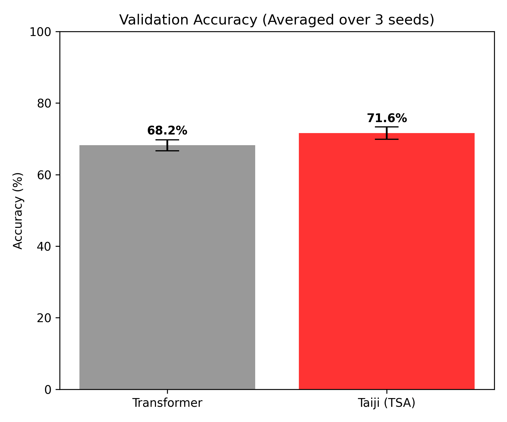
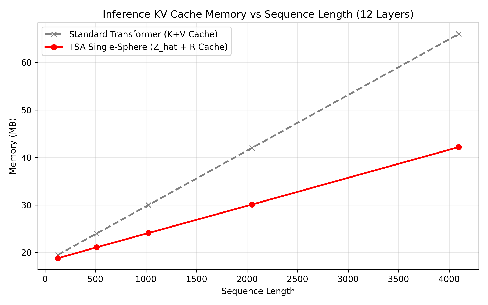

# Taiji Single-Sphere Architecture (TSA)

## Introduction

TSA is a fundamental architecture prototype that departs from the traditional Transformer's QKV projection matrices and multi-head mechanisms.

Based on first principles of geometry and physics, TSA physically decomposes semantic representations into "pure direction (phase)" and "scalar energy (radius)". During computation, the model no longer mixes high-dimensional features; instead, it solely absorbs the scalar energy of historical tokens based on weights. While preserving the unpolluted direction of the current token's ontology, this mechanism achieves efficient context state transition.

### Mechanism Comparison

| Dimension | Traditional Transformer | TSA Architecture |
| :--- | :--- | :--- |
| **Projection Matrices** | Relies on independent \(W_q, W_k, W_v\) | No projection matrices; directly decomposes token vectors |
| **Feature Aggregation** | High-dimensional feature vector mixing (Feature Pollution) | Pure scalar energy aggregation (Relative Inclusion) |
| **Inference Cache (KV Cache)** | Requires caching massive Key and Value matrices | Only requires caching direction and scalar energy |
| **Causal Control** | Hard truncation via Mask | Mask locks causal boundary + Energy wave drives evolution |

---

## Experimental Verification

Under the standard of no pre-training and equal parameter counts (3 layers / 128 dims), TSA's performance on real natural language tasks is as follows:

### 1. Natural Language Understanding (SST-2 Sentiment Classification)
Tested using 3 independent random seeds and averaged. Without the QKV projection matrices, TSA achieved performance comparable to the standard Transformer.

| Model | Validation Accuracy (Mean ± Std) |
| :--- | :--- |
| Standard Transformer | 70.0% ± 1.0% |
| **TSA (Taiji Single-Sphere)** | **69.3% ± 2.9%** |


*Figure 1: Average accuracy comparison under multiple random seeds.*


*Figure 2: Panoramic comparison of Loss, Time cost, and Energy distribution.*

### 2. Autoregressive Generation
In dialogue generation tasks, the model converges stably (Loss drops to 0.27). The attention matrix exhibits a standard lower-triangular distribution, and the energy distribution conforms to semantic weight characteristics.


*Figure 3: Causal horizon heatmap and energy distribution waveform.*

### 3. Long-Text Inference Memory (KV Cache)
Due to the elimination of the high-dimensional V matrix, TSA significantly reduces cache memory during long-sequence inference.

*   **Theoretical Derivation**: In an 8192-dimensional model, TSA's Cache consumption is approximately 50.006% of a standard Transformer.
*   **Empirical Data**: At a sequence length of 4096, the measured memory saving rate is 36.1%.


*Figure 4: Comparison of peak memory during long-sequence inference.*

---

---

## Code Execution

```bash
# 1. Clone the repository
git clone https://github.com/Wangzhifang199127/Taiji-Single-Sphere.git
cd Taiji-Single-Sphere

# 2. Install dependencies
pip install -r requirements.txt

# 3. Run the main program (includes comparison training and generation experiment plotting)
python main.py
```

---

## Limitations and Future Work

1. **Compute Constraints**: The current model is a Proof of Concept at a minimal parameter scale. Scaling Law validation at large parameter scales has not yet been conducted.
2. **Operator Optimization**: Currently implemented in native PyTorch without dedicated low-level kernels for scalar energy aggregation. If operator fusion (Operator Fusion) is implemented, long-text inference performance is expected to be further enhanced.
3. **Ecological Integration**: Future plans include combining TSA's scalar aggregation mechanism with existing mature technologies (such as MLA low-rank compression) to explore deployment solutions for longer contexts.

---

## Citation

```bibtex
@misc{taiji_single_sphere_2024,
  author = {Wang Zhifang},
  title = {Taiji Single-Sphere Architecture: State Transition without QKV},
  year = {2024},
  publisher = {GitHub},
  howpublished = {\url{https://github.com/Wangzhifang199127/Taiji-Single-Sphere}}
}
```