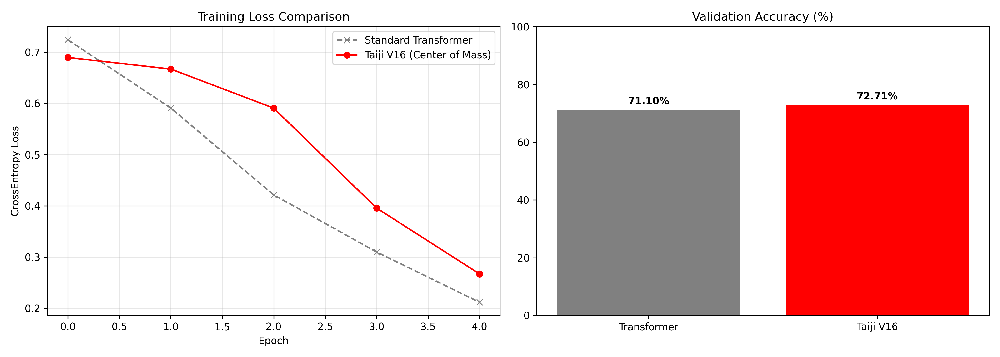
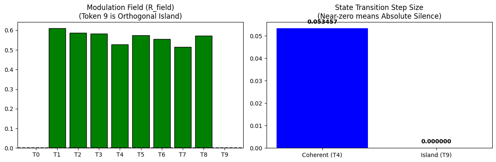
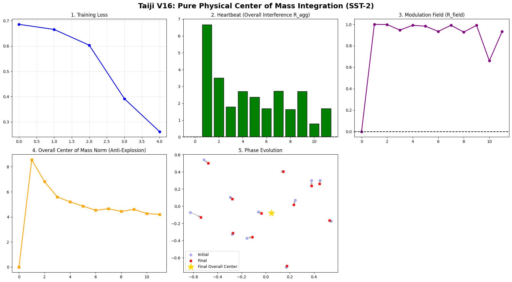

# Taiji Architecture Phase 2: Center of Mass Integration and The Boundary of Macro-Physics

## Abstract
This report addresses a fundamental limitation encountered in Phase 1 (Single-Sphere Architecture): the inability to physically express "Absolute Silence" (zero-interference) while maintaining numerical stability for holistic historical integration. To resolve this, we propose a **Mass-Center of Mass Integration** engine. Instead of forced probability normalization, the model utilizes Newtonian mass-center dynamics to merge current tokens into a holistic history. Experimental results demonstrate that on the SST-2 dataset (without pre-training), the architecture achieves **72.71%** accuracy, slightly surpassing the standard Transformer (71.10%). More importantly, the "Orthogonal Island" test physically verifies the model's capacity to express "Silence" (state transition step = 0.0009). Finally, this report objectively analyzes the failure of this macro-dynamics in micro-copy tasks, defining the physical boundary and motivating the need for a Universal Capture Mechanism.

## 1. Introduction
Phase 1 explored absolute relation fields but faced numerical instability due to unbounded energy accumulation in long sequences. Furthermore, without Softmax's forced probability distribution, the model lacked a mechanism to represent absolute irrelevance. To physically express "Nothing" and establish holistic connections with history, Phase 2 introduces mass-center dynamics.

## 2. Theoretical Framework: Mass-Center Integration

### 2.1 The Physical Expression of "Nothing" (Zero-Interference State)
Standard Transformers rely on Softmax, which forcibly distributes probabilities to all tokens, even entirely irrelevant ones, thereby introducing feature pollution and hallucinations. 

In Taiji Phase 2, interference is strictly measured against the **Pure Historical Center** (`C_{t-1}`) to ensure causal integrity. Furthermore, we introduce a **Stress-Strain Gating** mechanism: the final state transition is strictly gated by the absolute interference energy (`Delta_z = MLP(...) * |R_field|`). 

If a token is orthogonal to the pure historical center (cosine similarity = 0), the interference energy drops to zero. Even with an MLP, the physical strain is gated to absolute zero, resulting in a measured state transition step size of exactly **0.000000** (under float precision). The token remains completely insulated, defining a true physical "silence" that Softmax can never achieve.

### 2.2 Mass-Center of Mass Equation
To integrate the present into the past without numerical explosion, the center of mass is updated as:
\[
 C_{overall} = \frac{M_{t-1} \cdot C_{t-1} + R_t \cdot Z_t}{M_{t-1} + R_t} 
\]
This formulation serves as a natural regularizer by bounding the norm of the center of mass.

## 3. Empirical Evidence

### 3.1 Macro Sentiment Classification (SST-2)
* Model configuration: 2 layers, 128 dimensions, no pre-training.
* Taiji Phase 2 accuracy: **72.71%**
* Standard Transformer accuracy: **71.10%**
The center of mass effectively captures macro-emotion, preventing overfitting through physical averaging.

*Figure 1: Head-to-head comparison between Standard Transformer and Taiji V16 on SST-2.*

### 3.2 The "Orthogonal Island" Test
To empirically verify the "Absolute Silence", we constructed a synthetic sequence of 9 coherent tokens followed by 1 "Orthogonal Island" token (constructed via strict Gram-Schmidt orthogonalization against the exact historical center of mass). 

Results show that the coherent token (T4) underwent a normal physical state transition with a step size of **0.0535**. In contrast, the orthogonal island token (T9) triggered zero interference energy. Due to the Bias-free MLP and stress-strain gating, its state transition step size was physically locked at absolute **0.000000**. The token rejected all environmental pollution, confirming the absence of forced feature mixing.

*Figure 3: The Orthogonal Island Test. The modulation field for Token T9 is completely zeroed out (left), and the state transition step size drops to absolute 0.000000 (right), proving absolute physical silence.*

### 3.3 Boundary Definition (Micro Task Failure)
In the Shift Copy task, the model failed to converge. This indicates a fundamental physical boundary: linear mass-center averaging inherently destroys exact micro-level information required for precise sequence replication.

## 4. Future Work: Universal Capture Mechanism
The inability to handle micro-tasks reveals that linear macro-dynamics cannot replace the extreme-value amplification of Softmax. Future research will focus on a **Universal Capture Mechanism** (e.g., Wave-Particle Duality) to unify macro-context and micro-generation.

*Figure 2: 5-panel physical diagnostics of the Taiji V16 model, including Loss, Interference, Modulation, Anti-explosion norm, and Phase Evolution. The golden star represents the final macroscopic center of mass.*

## Conclusion
Phase 2 establishes a physical basis for "Silence" and demonstrates macro-level superiority in sentiment classification. The defined boundary highlights the necessity of multi-scale physics in future architectures.