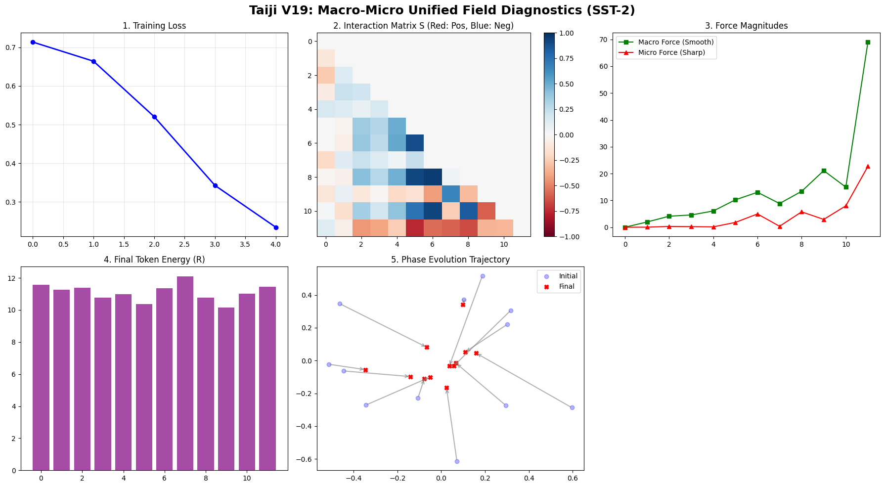

# Taiji Phase 3: Macro-Micro Unified Field (V19 Prototype)

## Introduction

While Phase 2 (Center of Mass) successfully captured macro-level sentiment, it suffered from "information annihilation"—linear averaging destroys exact micro-level memory (Copy tasks). 

Conversely, a pure Micro-level Resonance approach (using `ReLU`) achieved perfect Copy precision but destroyed negative semantics (imposing a false, overly positive gravitational collapse).

Phase 3 introduces the **Macro-Micro Unified Field**. By replacing the forced zero-sum probability (Softmax) and the biased `ReLU` with a **signed multi-order force field**, we successfully unify global context (macro) and exact sequence retention (micro).

## Core Mathematical Formulation

Instead of normalizing probabilities, we calculate the physical forces acting on the current token:

1. **Macro Force (Global Context)**: First-order smooth attraction.
   \[ F_{macro} = \sum_{j < t} S_{ij} (Z_j - Z_i) \]
2. **Micro Force (Exact Resonance)**: Third-order sharp resonance, preserving both positive and negative signs.
   \[ F_{micro} = \sum_{j < t} S_{ij}^3 (Z_j - Z_i) \]

Where \( S_{ij} \) is the phase similarity (cosine). The final state extrapolation is:
\[ Z_{out} = Z_{in} + \text{MLP}(Z_{in}) + \eta_{macro} F_{macro} + \eta_{micro} F_{micro} \]

## Experimental Results

This unified field prototype demonstrates the ability to perform both micro-level replication and macro-level understanding simultaneously.

*   **Copy Task (Micro Memory)**: Loss drops to **0.0096**. (Retains exact sequence without annihilation).
*   **SST-2 Sentiment Classification (Macro Understanding)**: Accuracy reaches **69.27%** without pre-training. (Retains the ability to capture global emotional context).
*   **Negative Semantics**: Successfully preserved. The interaction matrix no longer collapses into uniform positive values, but displays a natural, balanced distribution of red (positive resonance) and blue (negative repulsion).


*Figure: V19 Unified Field Diagnostics. Note the red/blue interaction matrix and the balance of macro (green) and micro (red) forces.*

## Code Execution

```bash
cd phase3_unified_field
python main.py
```

*(Note: This is an active research prototype. The next step will introduce Lagrangian mechanics and momentum for true trajectory extrapolation.)*