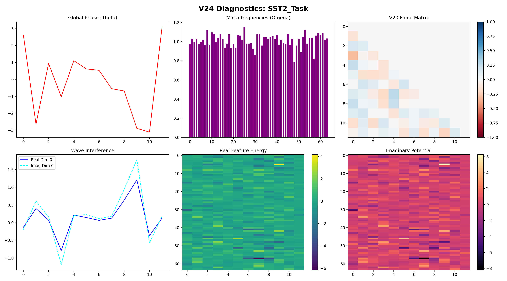

# Taiji-Single-Sphere (V24): A Physics-Informed White-box Sequence Model

## 💡 Overview
Standard LLMs rely on statistical black boxes (QKV + Softmax). **V24** replaces this with a pure physics-driven engine: **V20 Force Fields** and **Complex Phase Interference**. 

**Key Achievements:**
*   No QKV, No Multi-Head Attention.
*   Matches single-layer Transformer on SST-2 (67.55% vs 67.09%).
*   Fully interpretable: you can literally *see* semantic reversals as 180-degree phase flips.

## 📊 Visual Diagnostics (The Magic of White-Box)

*Left: Global Phase Shift. Right: Real/Imaginary Interference.*

## ⚙️ Core Architecture
## ⚙️ Core Architecture

### 1. V20 Force Field (Replacing Attention)
We compute pure directional inner products \(S_{ij}\) to avoid high-frequency bias, followed by displacement-based force fields.

$$
S_{ij} = \frac{Z_i}{\|Z_i\|} \cdot \left( \frac{Z_j}{\|Z_j\|} \right)^T
$$

### 2. Macro-Phase Generation (Replacing Softmax)
A lightweight MLP outputs a single scalar phase angle \(\theta_{global}\).

### 3. Complex Interference (Mamba SSM Backbone)
Features are decoupled by learnable frequencies \(\omega_d\):

$$
\theta_d = \theta_{global} \odot \omega_d
$$

Then rotated in the complex plane:

$$
h_{rot}^{real} = h_{t-1}^{real} \cos\theta_d - h_{t-1}^{imag} \sin\theta_d
$$
$$
h_{rot}^{imag} = h_{t-1}^{real} \sin\theta_d + h_{t-1}^{imag} \cos\theta_d
$$
## 🚀 Quick Start

    pip install torch datasets transformers matplotlib numpy scikit-learn
    python main.py

## 🤝 Call for Collaboration

I am an independent researcher. V24 is a tiny proof-of-concept. I am looking for feedback on:

1. How to formally prove the convergence of phase rotation?
2. How to scale V24 to multi-layer architectures?

*Feel free to open an issue on [GitHub](https://github.com/Wangzhifang199127/Taiji-Single-Sphere)*
